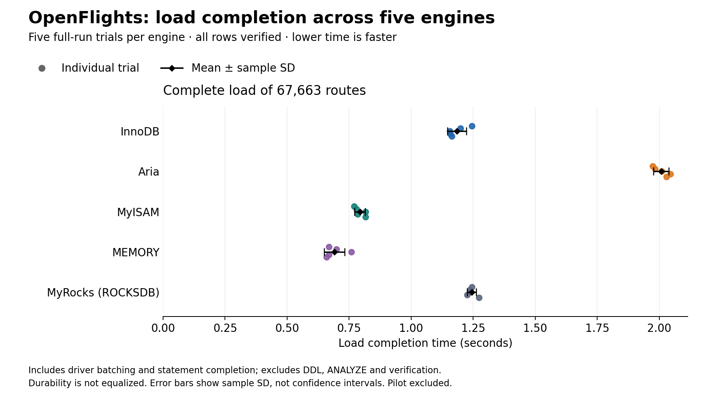

A project for area 6, "Choosing the right storage engine" for the [MariaDB student database projects, 2026-09](https://mariadb.org/bachelor_hackathon_2026-09/).

# CU Databases Project: choosing a storage engine

We use Python and MariaDB 11.8.9 to compare **InnoDB, Aria, MyISAM, MEMORY and MyRocks**
(SQL engine name `ROCKSDB`). The project measures load/read performance, concurrent
updates, storage allocation and acknowledged-row survival after process restarts.
The runnable code, raw evidence and reports are on `main`.

## Which engine, and what does it cost?

| Engine | OpenFlights load (s) | OpenFlights scan (ms) | Synthetic disk growth (MiB) | Starting recommendation |
| --- | ---: | ---: | ---: | --- |
| InnoDB | 1.1840 ± 0.0383 | 11.4745 ± 0.4860 | 9.129 | Transactional application data; largest measured small-table growth |
| Aria | 2.0078 ± 0.0305 | 9.7694 ± 0.4150 | 3.730 | Persistent non-transactional reference scans; slower loading here |
| MyISAM | 0.7932 ± 0.0213 | 10.3507 ± 0.3222 | 1.266 | Rebuildable loading-focused workloads; crash-table warnings in every forced trial |
| MEMORY | 0.6906 ± 0.0410 | 5.7458 ± 0.3325 | 0.121 overhead only | Rebuildable RAM cache; every tested restart emptied its rows |
| ROCKSDB | 1.2440 ± 0.0182 | 18.8477 ± 0.3985 | 1.168 | Investigate storage-constrained workloads; slowest scan here |

Read/load values are mean ± sample SD across **five trials of 67,663 real routes**.
Disk growth comes from a **separate 10,000-row synthetic experiment**, includes logs and
restart effects, and is not bytes per route. MEMORY's separate live allocation was
8.725 MiB for that synthetic table. The four persistent engines preserved all 1,000
acknowledged rows in each tested clean/forced restart; this does not prove power-loss
durability or transactional equivalence.

See the [decision guide](docs/engine-recommendations.md) for requirements, mechanisms
and evidence. There is no universal winner. In the [CPU diagnostic](docs/cpu-findings.md),
changing the load generator's quota substantially changed throughput, demonstrating
why client limits must be checked before judging engine scaling.

A separate [MEMORY index experiment](docs/memory-index-findings.md) changes only HASH
versus BTREE: at 100,000 rows, the 10-row range took 13.52 times as long with HASH.
Plans and counters showed a table scan versus index-range access; equality means
were similar. This is a scoped mechanism result, not a new five-engine ranking.



## Start here

To explore without installing anything, read the [full OpenFlights summary](evidence/openflights/20261009T160813Z-openflights-6884f225/summary.md)
and [findings](docs/openflights-findings.md), then the [decision guide](docs/engine-recommendations.md).

To run the project, install **Git, Python 3.9+ and Docker with Compose**, start Docker,
and use **Linux amd64 containers**. Windows Docker Desktop and Ubuntu amd64 are the
primary paths. Initial setup needs internet access. The DB/runner limits are 2 GiB/512 MiB;
allow extra memory for Docker and builds. For Linux permissions, ARM limitations,
manual steps and troubleshooting, see [setup details](docs/setup.md).

For a new checkout:

```powershell
git clone --branch main https://github.com/majdsl/CU-Databases-Project.git
cd CU-Databases-Project
python scripts/setup_project.py
```

After cloning, **setup is one command**. On Linux use `python3 scripts/setup_project.py`.
The wrapper verifies Docker, preserves/creates local credentials, fetches checksum-verified
data, builds containers, checks result-write permissions, runs unit tests and checks
all five actual engines. Success ends with **`SETUP PASS`**. Stop on errors.
Setup runs no benchmark and never deletes volumes. It can recreate this lab's container,
so do not run it during active measurements.

Keep `.env` private and unchanged for an existing database. A second clone shares the
normal Compose project name; it is not automatically an isolated database.
Stop the lab with `docker compose stop` to preserve data.

## Run one comparison and read the result

Keep power conditions stable and replace the label with your actual settings:

```powershell
docker compose run --rm runner python -m benchmarks.openflights --pilot --power-condition "plugged in; battery saver off"
```

Expect five engine trials and a summary marked **PILOT**. Every loaded row and query
answer is checked. The saved container path `/results/<run-id>` maps to
`results/<run-id>` in your checkout. Open `summary.md`; retain `results.json` for the
raw samples, checksums, query plans and runtime/settings metadata. One pilot round cannot
estimate variability. Investigate partial/failed output before proceeding.

After reviewing the pilot:

```powershell
docker compose run --rm runner python -m benchmarks.openflights --full --power-condition "plugged in; battery saver off"
```

This runs 25 trials, placing each engine once in each position over five rounds.
Timings on another machine need not be identical. Compare the conditions and variation,
and keep pilot observations separate from full-run statistics.

**Worked interpretation:** MEMORY loaded the archived route table in 0.6906 ± 0.0410 s,
versus InnoDB's 1.1840 ± 0.0383 s. That advantage can help a rebuildable cache.
Our separate restart test lost all MEMORY rows even after clean shutdown, so speed alone
does not justify using it for the only copy of authoritative data. The linked reports
show all trials and qualify each conclusion.

## Data model and measurement method

| Dataset | Design | Reason |
| --- | --- | --- |
| Seeded synthetic flight events | Integer event key; route/time index; integer fare, delay and passenger fields; bounded high-entropy payload | Reproducible updates and integrity checks without monetary floating-point rounding |
| Pinned OpenFlights routes | Source-row key; nonunique source/destination index; nullable original IDs | Preserve repeated route combinations and missing IDs instead of silently dropping records |

Each engine receives the same rows, logical schema and query stream **within an experiment**.
The shared flight schemas use explicit BTREE declarations and utf8mb4_bin to avoid
MEMORY's default HASH index as a confounder. The separate integer-only index experiment
deliberately changes HASH versus BTREE.
Physical storage still differs. No foreign keys or engine-specific alternatives are added
to the common schema; this is not a complete airline application. See the
[synthetic schema rationale](docs/benchmark-method.md), [route transformation](docs/openflights-method.md)
and directly comparable [SQL schemas](sql/openflights/).

The harness verifies the actual engine, checks every loaded value and validates query
answers. Verification warms caches. Timings include driver/network work; read statistics
summarize trial means, not pooled queries. The flight comparisons use five repeats; the MEMORY index comparison uses six.
These are repeats on one laptop, not independent machines. [Recorded cache and durability settings](docs/cache-and-durability.md) explain why
equal configured cache sizes are not equal total memory or durability guarantees.

Storage uses stopped-server inventories on fresh volumes. Recovery uses clean versus
SIGKILL restarts between acknowledged statements, with the host/cache still running.
Neither test establishes physical SSD footprint, device power-loss behaviour, interrupted
transactions or steady-state MyRocks compaction.

## Explore or reproduce the other experiments

| Question | Method and commands | Findings and evidence |
| --- | --- | --- |
| Synthetic loading and warm reads | [Baseline](docs/benchmark-method.md) | [Original baseline](evidence/baseline/20260923T121610Z-92b1c313/README.md) |
| Concurrent updates and client CPU limits | [Concurrency](docs/concurrency-method.md), [CPU diagnostic](docs/cpu-diagnostic.md) | [CPU findings](docs/cpu-findings.md) |
| Persistent allocation versus live RAM | [Storage procedure](docs/storage-method.md) | [Storage findings](docs/storage-findings.md) |
| Rows surviving clean/process-crash restarts | [Isolated recovery procedure](docs/recovery-method.md) | [Recovery findings](docs/recovery-findings.md) |
| InnoDB table size versus buffer pool (measurements pending) | [Isolated cache-pressure protocol](docs/cache-pressure-method.md) | Laptop pilot/full pending |
| MEMORY index access paths | [HASH versus BTREE protocol](docs/memory-index-method.md) | [Index findings and charts](docs/memory-index-findings.md) |
| Real route data and secondary-index queries | [OpenFlights](docs/openflights-method.md) | [Route findings](docs/openflights-findings.md) |

Read reports without rerunning experiments. The storage/recovery harnesses use isolated
temporary projects; never manually crash the normal lab database. Failed trials preserve
diagnostic evidence. The historical route snapshot is OpenFlights data, via MariaDB/openflights,
under [ODbL 1.0](data/openflights/LICENSE); its [download manifest](data/openflights/manifest.json)
pins the source and checksum. Synthetic events are complementary generated data, not real flights.

Five report generators cover 18 chart files; the MEMORY report adds verified index-mechanism evidence. See
[report reproduction commands and checks](docs/report-reproducibility.md).
CI uses fresh containers and runs unit tests plus real five-engine checks;
see [CI scope](docs/ci.md). Performance measurements stay on controlled machines.
The [laptop record](docs/benchmark-environment.md), [runner image pin](docs/runner-image.md)
and [setup details](docs/setup.md) document versions and remaining environment limits.

## Team and further review

Constructor University database course, Fall 2026. Full names, GitHub identities and
completed contributions will be added after team confirmation; ongoing review is not
presented as finished work. Follow-up changes use branches and pull requests into `main`,
the branch read by the official evaluator. Remaining evidence gaps are tracked in the
[evidence plan](docs/evidence-plan.md); this is not a claim of a final grade.

References: [official assignment and rubric](https://mariadb.org/bachelor_hackathon_2026-09/),
[MariaDB engine documentation](https://mariadb.com/docs/server/server-usage/storage-engines).
