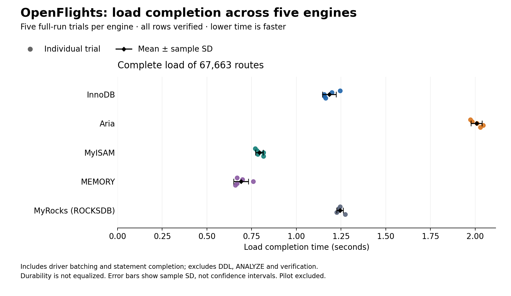

A project for area 6, "Choosing the right storage engine" for the [MariaDB student database projects, 2026-09](https://mariadb.org/bachelor_hackathon_2026-09/).

# CU Databases Project: choosing a storage engine

We use Python and MariaDB 11.8.9 to compare **InnoDB, Aria, MyISAM, MEMORY and MyRocks**
(SQL engine name `ROCKSDB`). The project measures load/read performance, concurrent
updates, storage allocation and acknowledged-row survival after process restarts.
The runnable code, raw evidence and reports are on `main`.

## Which engine, and what does it cost?

| Engine | OpenFlights load (s) | OpenFlights scan (ms) | Synthetic disk growth (MiB) | Starting recommendation |
| --- | ---: | ---: | ---: | --- |
| InnoDB | 1.1840 ± 0.0383 | 11.4745 ± 0.4860 | 9.129 | Transactional application data; largest measured small-table growth |
| Aria | 2.0078 ± 0.0305 | 9.7694 ± 0.4150 | 3.730 | Persistent non-transactional reference scans; slower loading here |
| MyISAM | 0.7932 ± 0.0213 | 10.3507 ± 0.3222 | 1.266 | Rebuildable loading-focused workloads; crash-table warnings in every forced trial |
| MEMORY | 0.6906 ± 0.0410 | 5.7458 ± 0.3325 | 0.121 overhead only | Rebuildable RAM cache; every tested restart emptied its rows |
| ROCKSDB | 1.2440 ± 0.0182 | 18.8477 ± 0.3985 | 1.168 | Investigate storage-constrained workloads; slowest scan here |

Read/load values are mean ± sample SD across **five trials of 67,663 real routes**.
Disk growth comes from a **separate 10,000-row synthetic experiment**, includes logs and
restart effects, and is not bytes per route. MEMORY's separate live allocation was
8.725 MiB for that synthetic table. The four persistent engines preserved all 1,000
acknowledged rows in each tested clean/forced restart; this does not prove power-loss
durability or transactional equivalence.

### Why the results differ

| Engine / mechanism | What our evidence shows | Interpretation boundary |
| --- | --- | --- |
| **InnoDB:** clustered B-tree pages, transactional logging and a buffer pool | Largest small-table datadir growth here; tables exceeding the fixed pool generated read activity | Page/log allocation and cache capacity matter; we did not isolate the cost of each durability feature. |
| **Aria:** table-level writes and crash-safe PAGE/log options | Concurrent writers waited even on different rows, with little gain from two to four clients | Lock counters support observed contention; read timings do not isolate its page-cache design. |
| **MyISAM:** separate data/index storage, table locks and no transactions | Fast persistent-engine loading here; table waits and forced-restart warnings were recorded | Loading speed does not supply transactional safety or eliminate a recovery/repair burden. |
| **MEMORY:** RAM-resident rows with HASH or BTREE indexes | Rows vanished on restart; HASH range queries scanned while BTREE used range access | Volatility and index access were demonstrated; all flight-read engines were warm, so fast reads alone do not isolate disk avoidance. |
| **MyRocks:** LSM organization, compression and compaction | Separate codec trials reduced repetitive table SST bytes by 95.15% with ZSTD, but high-entropy bytes by only 0.44% | Payload compressibility matters. This flush-only result does not isolate the cause of the earlier flight timings or measure steady-state compaction. |

The [index](docs/memory-index-findings.md), [cache-pressure](docs/cache-pressure-findings.md),
[compression](docs/rocksdb-compression-findings.md) and [lock-counter](docs/write-diagnostics-findings.md) experiments test specific
mechanisms. The [cache/durability inventory](docs/cache-and-durability.md) explains
why matching configured cache sizes does not equalize total memory or guarantees.

**Image provenance:** the cache-pressure, write-diagnostic and compression orchestrators rebuild
at the start of each invocation, so pilot and full runs selected separately built
images. Their recorded source/settings/runtime matched, but image IDs differed.
The archived records do not identify which image bytes or metadata changed; pilot
and full statistics stay separate. See the [recorded identities and limits](docs/image-provenance.md).

See the [decision guide](docs/engine-recommendations.md) for requirements, mechanisms
and evidence. There is no universal winner. In the [CPU diagnostic](docs/cpu-findings.md),
changing the load generator's quota substantially changed throughput, demonstrating
why client limits must be checked before judging engine scaling.

The [October 30 cloud Linux reproduction](docs/openflights-linux-reproduction.md)
passed fresh five-engine setup and OpenFlights pilot/full runs. Its raw evidence and
per-engine comparison are archived separately from the laptop measurements above;
shared cloud timings do not establish a Linux-versus-Windows effect. Zane's independent
physical-laptop reproduction remains pending.

A separate [MEMORY index experiment](docs/memory-index-findings.md) changes only HASH
versus BTREE: at 100,000 rows, the 10-row range took 13.52 times as long with HASH.
Plans and counters showed a table scan versus index-range access; equality means
were similar. This is a scoped mechanism result, not a new five-engine ranking.



## Start here

To explore without installing anything, read the [full OpenFlights summary](evidence/openflights/20261009T160813Z-openflights-6884f225/summary.md)
and [findings](docs/openflights-findings.md), then the [decision guide](docs/engine-recommendations.md).

### 1. Choose the path for your Docker engine

| Path | Platform | First successful result |
| --- | --- | --- |
| Five-engine lab: steps 2–6 below | Linux **amd64** containers; Windows Docker Desktop or native Linux | Verified OpenFlights pilot, then a repeated full comparison |
| Four-engine stock tutorial: step 2 below | Linux **amd64 or ARM64** containers, including Docker Desktop | SQL correctness transcript for InnoDB, Aria, MyISAM and MEMORY; no MyRocks or performance ranking |

Install **Git, Python 3.9+ and Docker with Compose**, start Docker, and ensure
`docker info` succeeds. Windows Docker Desktop must use Linux containers.
The custom five-engine image has not been validated on ARM; emulation is not a
validated performance path. The stock path has native Linux amd64/ARM64 and
Windows Docker Desktop [correctness evidence](docs/stock-tutorial-validation.md);
an interactive macOS walkthrough remains unverified.

Commands below run from the repository root. They use `python` in Windows
PowerShell; **use `python3` on Linux/macOS**. Initial setup needs internet access.
For the five-engine lab, allow memory beyond the DB/runner limits of 2 GiB/512 MiB
and check [Docker's actual disk capacity](docs/setup.md#disk-capacity) before building.

### 2. Get the code

For a new checkout, run:

```powershell
git clone --branch main https://github.com/majdsl/CU-Databases-Project.git
cd CU-Databases-Project
```

For an existing checkout, save your edits and run `git pull --ff-only` before
starting a new measurement session.

**Four-engine stock path:** run the following command now, then open the printed
output directory's `transcript.txt` and `validation.json`:

```powershell
python scripts/check_stock_tutorial.py
```

Expect **`STOCK TUTORIAL PASS`** and `Saved: ...` under `results/`. The driver creates
and removes its own disposable database and retains the transcript. This completes
the automated stock path; steps 3–6 are for the five-engine lab.
For interactive SQL and worked explanations, follow the [hands-on tutorial](docs/tutorial.md).
It covers indexes, locking, restart persistence and transaction rollback.

### 3. Set up the five-engine lab

**Native Linux only:** prepare the output directory for runner UID 10001 before setup:

```bash
mkdir -p results
setfacl -m u:10001:rwx results
```

If `setfacl` is missing, install the `acl` package using the
[native Linux instructions](docs/setup.md#native-linux-output-prerequisite).
Windows Docker Desktop does not need these POSIX ACL commands.
Rootless/user-remapped Docker and SELinux may need administrator-specific configuration;
the container write probe is the final check.

After those prerequisites, setup is one command:

```powershell
python scripts/setup_project.py
```

Expect the unit suite to finish with `OK`, five actual engine `PASS` lines, and
**`SETUP PASS`**. The wrapper creates or preserves private credentials, verifies the
dataset, builds images and checks output access. Stop on errors; use the
[setup troubleshooting table](docs/setup.md#common-failures-and-safe-stopping).
Setup runs no benchmark and never deletes volumes. It can recreate this lab's
container, so do not run it during active measurements.
Keep `.env` private and unchanged for an existing database. A second clone shares
the normal Compose project name; it is not automatically an isolated database.

## Run one comparison and read the result

### 4. Prepare an isolated measurement session

Setup leaves its database running. Stop it if it is your lab and nobody else is using it:

```powershell
docker compose stop db
```

If setup used `--project-name <name>`, use `docker compose -p <name> stop db` instead.
This retains its volume. Arrange a quiet measurement period, then prepare once:

```powershell
python scripts/run_openflights.py --prepare
```

Expect `Prepared immutable images. Session: .../session.json`. Copy that **exact
printed path** into each command below instead of `results/<session>/session.json`.
Preparation builds once, records both actual image IDs and reserves a separate
project name. The pilot starts its own database volume; the setup database and
credentials are preserved.
Keep the checkout, settings, images and power conditions unchanged through step 6:
do not pull, rebuild, commit, switch revisions or edit tracked files between stages.

### 5. Run the pilot and inspect your first result

Replace the power label with your actual settings; use the same description for full mode:

```powershell
python scripts/run_openflights.py --pilot --session "results/<session>/session.json" --power-condition "plugged in; battery saver off"
```

The launcher captures worker output, so it may be quiet until the worker exits.
Do not relaunch because output pauses. Success ends with
**`Pilot passed. Review its raw results/summary before invoking --full.`**
Inspect the same session file:

```powershell
python -m json.tool "results/<session>/session.json"
```

Check `status` is `pilot_completed` and `stages.pilot.status` is `completed`.
The field `stages.pilot.result.run_id` gives your `<pilot-run-id>`. Open
`results/<pilot-run-id>/summary.md` and `results/<pilot-run-id>/results.json`.
The summary must say **PILOT**; the JSON must have `status: "completed"` and five
trials, one per engine. Every row and query answer is checked. Keep the raw JSON
with its query plans, checksums and runtime/settings metadata. One pilot round
cannot estimate variability. Investigate failed/partial output before continuing.

### 6. Run full, stop cleanly and save the evidence

After reviewing the pilot, use the original **session path**, not the raw-run folder:

```powershell
python scripts/run_openflights.py --full --session "results/<session>/session.json" --power-condition "plugged in; battery saver off"
```

Expect **`Full run passed. Use --stop with this session to retain its database volume.`**
The session's `stages.full.result.run_id` locates the separate full-run summary and
raw JSON: 25 trials, five balanced rounds, mean ± sample SD of trial means.
Keep pilots and hosts separate; timings on another machine need not be identical.

```powershell
python scripts/run_openflights.py --stop --session "results/<session>/session.json"
python scripts/archive_openflights.py --session "results/<session>/session.json" --output "openflights-evidence.zip"
python -m zipfile -e "openflights-evidence.zip" "../openflights-evidence-check"
python "../openflights-evidence-check/verify.py"
```

Run each command separately and stop on errors. Choose new ZIP/extraction names if
those paths already exist. Expect `Saved evidence ZIP:` and **`BUNDLE CHECKSUMS PASS`**.
Stopping retains the database volume. The ZIP excludes `.env` and includes both raw
runs, session/build records, checksums and an offline verifier. Verification checks
byte integrity; it does not rerun SQL or establish authenticity.
Copy the ZIP somewhere durable: `results/` is ignored by Git and neither the ZIP
nor new measurements are uploaded automatically. The
[detailed launcher guide](docs/openflights-reproduction.md) covers diagnostics,
controls and the separate correctness-only smoke.

**Worked interpretation:** MEMORY loaded the archived route table in 0.6906 ± 0.0410 s,
versus InnoDB's 1.1840 ± 0.0383 s. That advantage can help a rebuildable cache.
Our separate restart test lost all MEMORY rows even after clean shutdown, so speed alone
does not justify using it for the only copy of authoritative data. The linked reports
show all trials and qualify each conclusion.

## Data model and measurement method

| Dataset | Design | Reason |
| --- | --- | --- |
| Seeded synthetic flight events | Integer event key; route/time index; integer fare, delay and passenger fields; bounded high-entropy payload | Reproducible updates and integrity checks without monetary floating-point rounding |
| Pinned OpenFlights routes | Source-row key; nonunique source/destination index; nullable original IDs | Preserve repeated route combinations and missing IDs instead of silently dropping records |

Each engine receives the same rows, logical schema and query stream **within an experiment**.
The shared flight schemas use explicit BTREE declarations and utf8mb4_bin to avoid
MEMORY's default HASH index as a confounder. The separate integer-only index experiment
deliberately changes HASH versus BTREE.
Physical storage still differs. No foreign keys or engine-specific alternatives are added
to the common schema; this is not a complete airline application. See the
[synthetic schema rationale](docs/benchmark-method.md), [route transformation](docs/openflights-method.md)
and directly comparable [SQL schemas](sql/openflights/).

The harness verifies the actual engine, checks every loaded value and validates query
answers. Verification warms caches. Timings include driver/network work; read statistics
summarize trial means, not pooled queries. The flight comparisons use five repeats; the MEMORY index comparison uses six.
These are repeats on one laptop, not independent machines. [Recorded cache and durability settings](docs/cache-and-durability.md) explain why
equal configured cache sizes are not equal total memory or durability guarantees.

Storage uses stopped-server inventories on fresh volumes. Recovery uses clean versus
SIGKILL restarts between acknowledged statements, with the host/cache still running.
Neither test establishes physical SSD footprint, device power-loss behaviour, interrupted
transactions or steady-state MyRocks compaction.

## Explore or reproduce the other experiments

| Question | Method and commands | Findings and evidence |
| --- | --- | --- |
| Synthetic loading and warm reads | [Baseline](docs/benchmark-method.md) | [Original baseline](evidence/baseline/20260923T121610Z-92b1c313/README.md) |
| Concurrent updates and client CPU limits | [Concurrency](docs/concurrency-method.md), [CPU diagnostic](docs/cpu-diagnostic.md) | [CPU findings](docs/cpu-findings.md) |
| Concurrent writes with database CPU and lock counters | [Isolated write diagnostic](docs/write-diagnostics-method.md) | [CPU and lock-wait findings](docs/write-diagnostics-findings.md) |
| Persistent allocation versus live RAM | [Storage procedure](docs/storage-method.md) | [Storage findings](docs/storage-findings.md) |
| Rows surviving clean/process-crash restarts | [Isolated recovery procedure](docs/recovery-method.md) | [Recovery findings](docs/recovery-findings.md) |
| InnoDB table size versus buffer pool | [Isolated cache-pressure protocol](docs/cache-pressure-method.md) | [Cache-pressure findings and charts](docs/cache-pressure-findings.md) |
| MEMORY index access paths | [HASH versus BTREE protocol](docs/memory-index-method.md) | [Index findings and charts](docs/memory-index-findings.md) |
| Real route data and secondary-index queries | [OpenFlights](docs/openflights-method.md) | [Route findings](docs/openflights-findings.md) |
| MyRocks compression on two controlled data profiles | [Isolated no-compression/ZSTD protocol](docs/rocksdb-compression-method.md) | [32-trial findings and charts](docs/rocksdb-compression-findings.md); [separate CI correctness](evidence/reviews/20261027-rocksdb-compression-ci/README.md) |

Read reports without rerunning experiments. The storage/recovery harnesses use isolated
temporary projects; never manually crash the normal lab database. Failed trials preserve
diagnostic evidence. The historical route snapshot is OpenFlights data, via MariaDB/openflights,
under [ODbL 1.0](data/openflights/LICENSE); its [download manifest](data/openflights/manifest.json)
pins the source and checksum. Synthetic events are complementary generated data, not real flights.

Eight report generators cover 32 chart files, including index, buffer-pool, compression and lock-wait evidence. See
[report reproduction commands and checks](docs/report-reproducibility.md).
CI uses fresh containers and runs unit tests, real five-engine checks and a
stock-image tutorial on native Linux amd64 and ARM64;
see [CI scope](docs/ci.md). Performance recommendations use the scoped laptop
experiments; cloud and shared-CI timings retain their separate validation labels.
The [laptop record](docs/benchmark-environment.md), [runner image pin](docs/runner-image.md)
and [setup details](docs/setup.md) document versions and remaining environment limits.

## Team and completed contributions

Constructor University database course, Fall 2026.

**All three team members have completed the contributions recorded below.**
Future improvements can be added to this completed record.

### Majd Salimoun

**Technical Lead and Project Engineer** · [majdsl](https://github.com/majdsl)

- **Technical Leadership and Project Engineering:** coordinated implementation,
  experiments and integration of the team's reviewed changes.

- **Database Platform and Five-Engine Integration:** built the MariaDB/Python
  environment and integrated InnoDB, Aria, MyISAM, MEMORY and MyRocks.

- **Benchmark and Data Engineering:** implemented seeded workloads, balanced trial
  ordering and complete row/query verification.

- **Experimental Execution and Evidence Management:** executed pilot/full
  measurements and preserved the raw results and runtime metadata.

- **Statistical Analysis and Data Visualization:** produced trial-level statistics,
  comparison charts and evidence-based engine recommendations.

- **Reproducibility Engineering and CI Automation:** automated setup, reporting
  workflows and correctness checks.

- **Technical Documentation and Research Communication:** wrote methods, findings,
  setup instructions and the project's evidence guide.

### Hassan Kheder

**Reproducibility and Quality Assurance Engineer** · [Hassan457-123](https://github.com/Hassan457-123)

- **Reproducibility Engineering:** reproduced all seven archived reports and
  checked that repeated generation preserved the numerical findings.

- **Data Analysis and Integrity Assurance:** reviewed statistics and figures;
  verified SHA-256 integrity of all 714 evidence files in his reviewed snapshot.

- **Defect Analysis and Validation Hardening:** diagnosed and repaired storage-report
  validation that disappeared under optimized Python.

- **Regression Test Engineering:** added six corrupted-evidence cases and passed
  the submitted test suite with normal and optimized Python.

- **Visualization Analysis and Refinement:** reviewed chart readability and
  clarified the MEMORY allocation legend.

- **Technical Reporting and Review Handoff:** supplied the patch, test logs,
  reproduction commands and review notes.

[Hassan's completed review and evidence](docs/teammate-1-review.md).

### Zeineldin Mohamed Hassan

**Evaluation Analyst and Tutorial Engineer** · [zein-935](https://github.com/zein-935)

- **Evaluation and Rubric Analysis:** ran the published evaluation prompt and
  reported criterion-level feedback.

- **Experimental Design and Method Review:** reviewed comparable schemas,
  workload choices and the connection between evidence and conclusions.

- **Data Evaluation and Mechanism Interpretation:** reviewed engine trade-offs,
  index access, table locking and restart persistence.

- **Technical Documentation and Learning Design:** revised reader guidance and
  connected setup, SQL examples and measured findings.

- **SQL Tutorial Engineering:** authored the initial walkthrough and seven SQL
  scripts demonstrating engine behavior.

- **Review Synthesis and Project Refinement:** communicated evaluation findings,
  including the need to assess `main`, to guide improvements.

[Zeineldin's completed review and evidence](docs/teammate-2-review.md).

See [team contributions and supporting evidence](docs/team-contributions.md) for
completed work, AI assistance, linked commits/reviews and the limits of each check.
Follow-up changes use branches and pull requests into `main`, the branch read by
the official evaluator. The [evidence plan](docs/evidence-plan.md) records the scope
of completed checks, historical review provenance and remaining reproduction work.

## License

The team's original project code and documentation are licensed under the
[MIT License](LICENSE).

The OpenFlights dataset and OpenFlights-derived data retain their
[ODbL 1.0 license](data/openflights/LICENSE) and
[source attribution](data/openflights/README.md). Third-party software, public
package inputs and externally sourced material keep their respective licenses;
the MIT license does not replace those terms.

References: [official assignment and rubric](https://mariadb.org/bachelor_hackathon_2026-09/),
[MariaDB engine documentation](https://mariadb.com/docs/server/server-usage/storage-engines).
