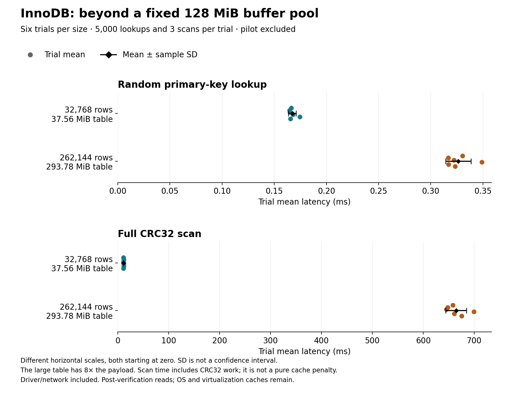
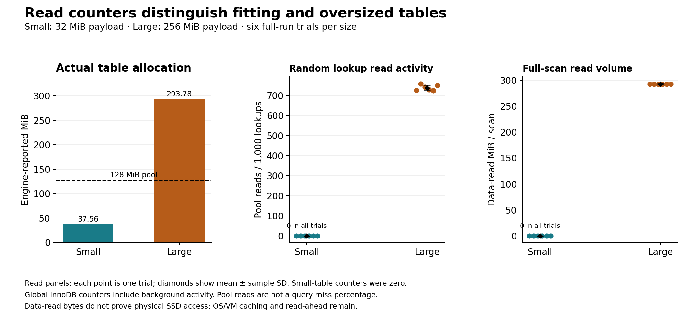

# InnoDB cache-pressure findings

**Verified full run:** `20261016T224612Z-cache-pressure-ca6cb57e` (October 17, 2026, Europe/Berlin; run IDs use UTC).
Twelve fresh-volume trials cover six rounds per table size: **1,769,472 verified row
loads, 60,000 timed lookups and 36 timed scans**. The separate two-trial pilot
`20261016T224159Z-cache-pressure-fe05dc09` was validated and excluded from all statistics and charts below.

## What changed when the table exceeded the pool

The buffer pool stayed at **128 MiB**. Actual engine-reported table allocation was
**37.56 MiB** for 32,768 rows and **293.78 MiB** for 262,144 rows in every trial.
The payload alone was 32 MiB versus 256 MiB; allocation includes row/index overhead.

The small table recorded **zero buffer-pool reads and zero data-read bytes** during
all measured lookup and scan windows. The large table recorded buffer-pool reads
in every window, including **3,622–3,789 reads per 5,000-query lookup phase**.
This supports the intended fitting-versus-oversized distinction at the InnoDB pool.
It does not mean physical SSD media were read: OS and virtualization caches remained.

Large-table mean lookup latency was **1.95×** the small-table mean.
Mean scan time was **58.71×**, but the large scan also processes **8× as much
payload**, computes CRC32 for every row, and triggers read-ahead. That ratio is not
an isolated cache-miss penalty. Table size changes B-tree shape and locality too;
a same-table/different-pool experiment would isolate capacity more closely.



## Complete timing summary

Mean ± sample SD across six trial means. Each lookup mean uses 5,000 queries; each
scan mean uses three scans. The experimental repeat is the trial, not each row,
lookup or scan. SD describes observed spread, not a confidence interval.

| Rows | Payload MiB | Table MiB | Lookup ms | Scan ms |
| ---: | ---: | ---: | ---: | ---: |
| 32,768 | 32 | 37.56 | 0.1673 ± 0.0036 | 11.3165 ± 0.3137 |
| 262,144 | 256 | 293.78 | 0.3265 ± 0.0121 | 664.3568 ± 20.1780 |

All 24 trial/phase observations are in the [CSV](data/cache-pressure-observations.csv).
The [statistics JSON](data/cache-pressure-statistics.json) retains timing distributions,
phase counters, provenance and canonical hashes. Raw evidence retains every timing,
query ID, counter snapshot and separate worker result. No significance test or
independent-machine replication is claimed.

## Why the counter evidence matters



The small table's reads were satisfied without new InnoDB data reads during measured
windows. For the large table, random lookups generated read activity and each full
scan read approximately a table's worth of data. Repeated scans still generated
reads; three scans are not evidence of a fully steady state.

The read-activity chart normalizes lookup-phase pool reads per 1,000 queries; this is
**not a query miss percentage**. A lookup can touch multiple pages, and global counters
can include background work. Scan data-read bytes include prefetch/read-ahead and do
not count only the returned aggregate. `Innodb_buffer_pool_read_requests`, read-ahead,
wait-free, data-read operations/bytes and dirty/free/data page gauges are preserved.
EXPLAIN recorded PRIMARY/const for point queries and ALL for full scans in every trial.

Dirty pages were not equalized: the small trials had roughly 2,450 dirty pages before
lookups, whereas large trials had 6–13. The different load/flush history is a limitation,
not something to omit because the timings look consistent. We did not force checkpoints
or separate server CPU from client/network cost.

## Controls, verification and boundaries

- A new isolated Compose project and volume for every trial. Six rounds alternate
  size order; each size runs first three times. All 12 databases stopped cleanly,
  without recorded OOM kills. The normal lab volume was not used for these trials.
- Same integer-key/1,024-byte binary-payload schema, generation seed and fixed pool.
  Small-table rows are a prefix of the large dataset. Data generation uses SHAKE-256;
  every byte was checked by streamed verification. The host regenerated ordered SHA-256
  hashes and CRC32 scan oracles. Actual table size and pool size were checked.
- Full verification and 1,000 point warmups precede timed random queries. Three scans
  follow the lookup phase. This fixed phase order is post-verification, not cold-cache.
- MariaDB 11.8.9, Python 3.12.15, PyMySQL 1.1.2, WSL2 containers. Recorded power:
  `plugged in; battery saver off`. Runner quota: one CPU/512 MiB; isolated DB config:
  two CPUs/2 GiB. Quotas are not dedicated cores. Images and source identities are archived.
- Query cache off, strict/no-substitution mode, autocommit on. Buffer-pool size,
  maximum and shrink minimum fixed at 128 MiB; pool dump/load disabled. No cache
  flushing of the host, VM or storage device was attempted.
- Timing includes execute/fetch and driver/network work. Point answers return a full
  payload; scans return COUNT and SUM(CRC32(payload)). Scan timings are not directly
  comparable with the different SQL in the flight benchmarks. Load timing includes
  generation and is not presented here as server ingest throughput.

Pilot and full runs recorded different DB and runner image identities. Each identity
was constant within its own run; measured source hashes, selected settings, runtime
and server version matched. The cause of the identity change is not established by
these records, so byte-identical images across runs are not claimed. Pilot timings
are excluded, and both sets of identities are retained in derived provenance.

**Practical implication:** test the intended working set against the actual InnoDB
pool instead of extrapolating from a small warm table. These measurements show a
capacity-related change worth planning for; they do not establish a recommended pool
size for every application or justify replacing InnoDB with another engine. This is
one engine on one laptop, not a five-engine equal-budget benchmark, a host-RAM overflow
test, server-side contention measurement, or physical-storage latency measurement.

## Evidence and reproduction

- [Full results](../evidence/cache-pressure/20261016T224612Z-cache-pressure-ca6cb57e/results.json) and [original summary](../evidence/cache-pressure/20261016T224612Z-cache-pressure-ca6cb57e/summary.md).
- [Separate pilot](../evidence/cache-pressure/20261016T224159Z-cache-pressure-fe05dc09/results.json).
- Both directories preserve every `trial-NN.json`; all 14 worker files match their host records.
- [Protocol and run commands](cache-pressure-method.md), [recommendations](engine-recommendations.md).

Regenerate this report, data and charts without Docker or new database measurements:

```powershell
python -m pip install -r requirements-report.txt
python scripts/report_cache_pressure_findings.py
```

The generator validates both runs' schedules, controls, data/CRC oracles, footprints,
query streams, plans, counter deltas, clean stops, saved statistics and original
summaries. It compares every archived worker JSON with its host record and refuses
changes that invalidate the narrative. Canonical JSON hashes tolerate Git line-ending
conversion; original evidence and its captured source hashes are not rewritten.
See [report reproduction](report-reproducibility.md) for rendering limits.
