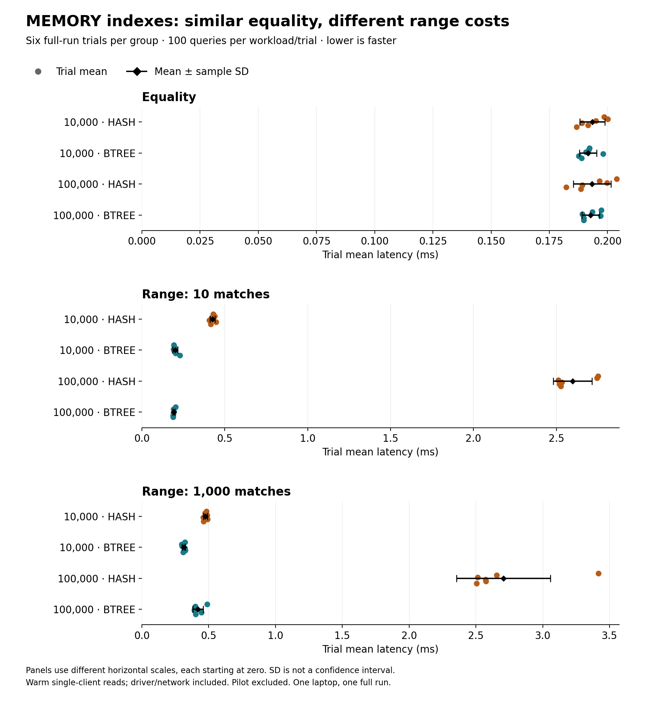
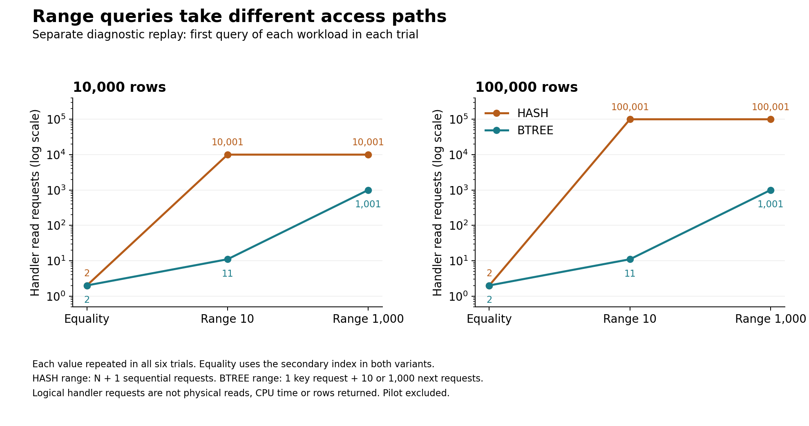

# MEMORY findings: why the index type matters

The full run `20261016T170049Z-memory-indexes-d7d3b1c7` contains **24 verified table trials**: six rounds at each of
10,000 and 100,000 rows, with both HASH and BTREE. Across trials, 1,320,000 loaded
rows and 7,200 timed query answers were checked. The four-trial pilot `20261016T163614Z-memory-indexes-6d072a50`
was separately validated and excluded from all statistics and charts below.

## Finding and practical recommendation

For these unique-key, warm-read workloads, equality means were nearly identical.
For ranges, BTREE had lower mean times at both sizes. At 100,000 rows, HASH took
**13.52 times as long** for the 10-row range and
**6.45 times as long** for the 1,000-row range.
These are ratios of observed group means, not confidence bounds or universal speedups.

The plans and counters support an access-path explanation: every recorded HASH range
query scanned the table, while every recorded BTREE range query used `probe_k`.
Only the secondary index type changed; primary key, integer columns, data, query
streams and settings were held constant within each round/size pair.

**Choose BTREE for a rebuildable MEMORY table that needs these kinds of range queries.**
This run provides no clear equality-latency reason to prefer HASH: observed equality
trial ranges overlap, and client overhead is included. It does not test duplicate-heavy
keys, writes, ordering, concurrency or memory exhaustion. Both variants remain volatile;
see the separate [restart evidence](recovery-findings.md). No index choice makes MEMORY durable.



## All full-run measurements

Mean ± sample SD across six **trial means**, each averaging 100 timed queries.
Queries and rows are not independent experimental repeats. SD is descriptive spread,
not a confidence interval. No significance test or independent-host replication is claimed.

| Rows | Index | Equality (ms) | Range 10 (ms) | Range 1,000 (ms) |
| ---: | --- | ---: | ---: | ---: |
| 10,000 | HASH | 0.1935 ± 0.0053 | 0.4257 ± 0.0157 | 0.4758 ± 0.0137 |
| 10,000 | BTREE | 0.1916 ± 0.0037 | 0.2010 ± 0.0142 | 0.3133 ± 0.0117 |
| 100,000 | HASH | 0.1934 ± 0.0081 | 2.5974 ± 0.1162 | 2.7059 ± 0.3523 |
| 100,000 | BTREE | 0.1928 ± 0.0038 | 0.1921 ± 0.0060 | 0.4197 ± 0.0390 |

| Rows | HASH/BTREE equality | HASH/BTREE range 10 | HASH/BTREE range 1,000 |
| ---: | ---: | ---: | ---: |
| 10,000 | 1.01× | 2.12× | 1.52× |
| 100,000 | 1.00× | 13.52× | 6.45× |

All 72 trial/workload observations are in the [CSV](data/memory-index-observations.csv).
The [statistics/provenance JSON](data/memory-index-statistics.json) includes distributions,
canonical evidence hashes and paired per-round HASH-minus-BTREE latency differences.
Those differences preserve pairing; ratios above are ratios of group means, not averages
of per-round ratios. No pilot sample enters either calculation.

## Mechanism evidence



Every trial recorded the actual MEMORY engine, a BTREE primary key on `id`, and the
requested secondary index on `k`. All normalized DDL matched beyond that index type.
Equality used `ref` access on `probe_k` for both variants, with one key and one next
request. The range diagnostics were consistent in all six rounds at both sizes:

| Secondary index | EXPLAIN access | Recorded range requests |
| --- | --- | --- |
| HASH | `ALL`, no selected index | `Handler_read_rnd_next=N+1`: 10,001 or 100,001 |
| BTREE | `range`, key `probe_k` | One `Handler_read_key`, plus 10 or 1,000 `Handler_read_next` |

The diagnostic is a separate replay of the first query of each workload, after timing;
it does not capture every timed query. Counts are logical handler requests, including
end-of-scan behavior, not physical I/O, CPU time or returned-row counts. EXPLAIN row
estimates need not equal actual matches. Plans were selected naturally without hints.
This supports the measured range mechanism; it does not separately measure pure index
traversal time or establish that every timing difference has only one cause.

## Conditions and limitations

- MariaDB `11.8.9-MariaDB-ubu2404`, Python 3.12.15 and PyMySQL 1.1.2 in WSL2 containers.
  Recorded power condition: `plugged in; battery saver off`.
- Session MEMORY table cap 128 MiB; query cache OFF; autocommit ON; strict mode and no
  engine substitution. The runner recorded one CPU quota and 512 MiB. The recorded
  Compose config gives the DB two CPUs and 2 GiB; these are limits, not dedicated cores.
- Each size/round pair uses identical seeded data and query streams. HASH and BTREE
  each run first three times per size; size order alternates. Schedule is deterministic.
- Every table is read completely for validation before queries, followed by warmup.
  One client and reused server; timings include driver/network work. No cold-cache or
  larger-than-memory conclusion follows, and client/server CPU time is not separated.
- Query order is fixed: equality, range 10, range 1,000. Server background work, host load
  and interactions with order are not independently controlled. Six rounds are on one host.
- The 1,000-row range selects 10% of the small table but 1% of the large one. This is
  fixed-cardinality range scaling, not constant-percentage selectivity scaling.
- Keys are a seeded permutation; `v` is nonindexed and must be read for the sum. No
  duplicate-heavy hash behavior, composite prefix, write cost or index-RAM comparison is claimed.

Pilot/full recorded source hashes, runtime and selected settings match; that does not
prove identical background host load. Historical source hashes retain Windows line endings.
Canonical JSON hashes identify parsed evidence independent of Git line-ending conversion.

## Evidence and reproduction

- [Full results](../evidence/memory-indexes/20261016T170049Z-memory-indexes-d7d3b1c7/results.json) and [original summary](../evidence/memory-indexes/20261016T170049Z-memory-indexes-d7d3b1c7/summary.md).
- [Separate pilot](../evidence/memory-indexes/20261016T163614Z-memory-indexes-6d072a50/results.json).
- [Protocol, schema and benchmark commands](memory-index-method.md).
- [Reusable engine recommendations](engine-recommendations.md).

The charts and this report are generated from archived evidence without Docker:

```powershell
python -m pip install -r requirements-report.txt
python scripts/report_memory_findings.py
```

The generator checks both runs' schedule, data hashes, query streams and answers, index
metadata, actual DDL, plan/counter patterns, session controls, original summaries and
recalculated statistics before writing outputs. It refuses changed evidence that would
invalidate this narrative. Historical raw results are not rewritten. See
[report reproducibility](report-reproducibility.md) for environment isolation and rendering limits.

References: [MariaDB MEMORY](https://mariadb.com/docs/server/server-usage/storage-engines/memory-storage-engine)
and [storage-engine index types](https://mariadb.com/docs/server/ha-and-performance/optimization-and-tuning/optimization-and-indexes/storage-engine-index-types).
