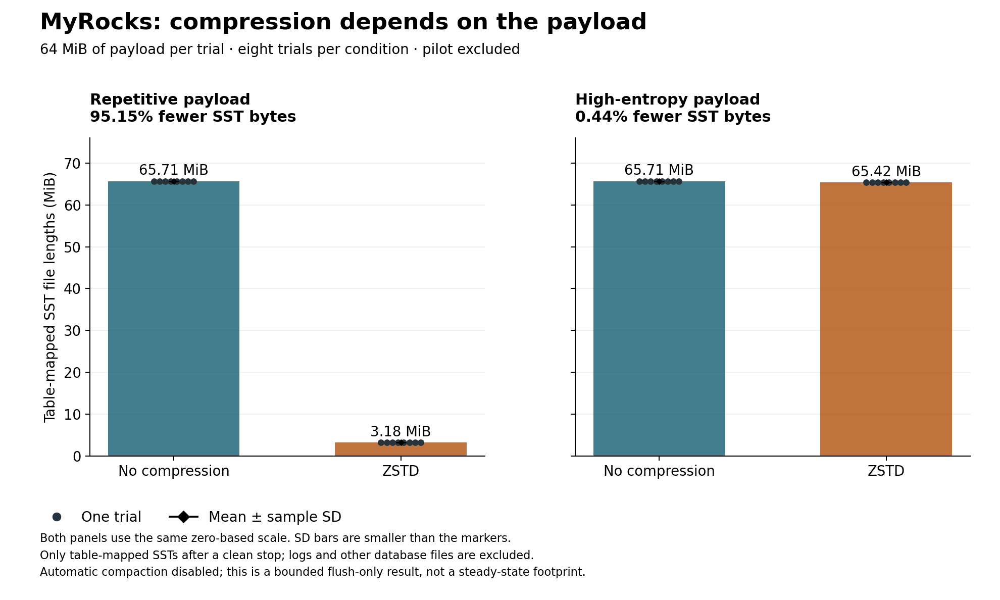
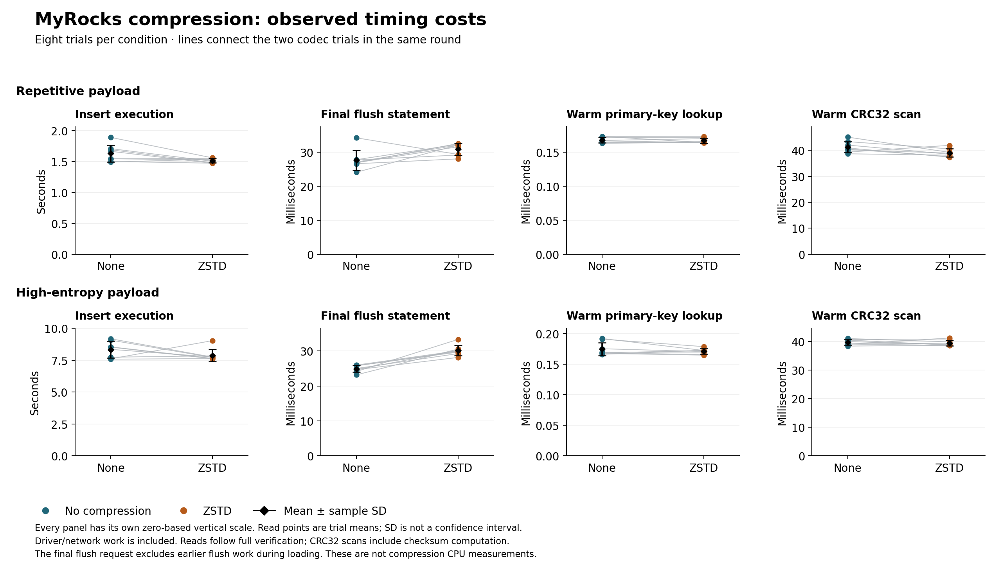

# MyRocks compression findings

**Full run:** `20261027T220128Z-rocksdb-compression-ea876f45`, measured October 27, 2026 (Europe/Berlin; run IDs use UTC).
The full run has **32 fresh-volume trials: eight per profile/codec condition**,
**2,097,152 verified row loads, 32,000 timed lookups and 160 timed CRC32 scans**.
The four-trial pilot `20261027T213812Z-rocksdb-compression-501c1299` was validated separately and contributes no observations
to these statistics or charts. Evidence was archived in `7dd87e4`.

## Compression changed file size much more for repetitive data

With the same **64 MiB payload per trial**, ZSTD reduced the repetitive table's
mapped SST file lengths from **65.7062 MiB to 3.1850 MiB**: **95.15% fewer bytes**.
The no-compression/ZSTD ratio of mean SST bytes was **20.63**.
For the deterministic high-entropy payload, SST lengths changed from **65.7062 MiB
to 65.4158 MiB**, only **0.44% fewer bytes**.

This is a within-MyRocks result on two synthetic payload profiles. It demonstrates
that a codec option's space benefit depends strongly on the values stored. It does
not turn the earlier OpenFlights results into a compression comparison.



## Complete file-size summary

All values are **mean ± sample SD across eight trial observations**. MiB is
1,048,576 bytes. The uncompressed SST lengths were identical across their eight
trials; their zero SD is observed, not a missing estimate.

| Payload | Codec | SST MiB | Allocated SST MiB |
| --- | --- | ---: | ---: |
| Repetitive payload | none | 65.7062 ± 0.0000 | 65.7148 ± 0.0000 |
| Repetitive payload | zstd | 3.1850 ± 0.0002 | 3.1953 ± 0.0000 |
| High-entropy payload | none | 65.7062 ± 0.0000 | 65.7148 ± 0.0000 |
| High-entropy payload | zstd | 65.4158 ± 0.0001 | 65.4258 ± 0.0000 |

Every trial mapped five unique SST files to the table through
`ROCKSDB_DDL`, `ROCKSDB_INDEX_FILE_MAP` and `ROCKSDB_SST_PROPS`. Their entry totals
covered all 65,536 verified rows. Actual file metadata reported `NoCompression` or
`ZSTD` as requested; CF options and file layout were unchanged during timed reads.
The report counts each mapped file once and excludes unrelated system SSTs.

File lengths were inventoried only after a clean database stop, from a read-only
mount. Allocated bytes are Linux `st_blocks × 512` inside the Docker volume.
Both metrics exclude WALs, logs and other datadir files. Neither is a physical SSD
footprint. The earlier [whole-datadir storage study](storage-findings.md) uses a
different metric and dataset.

## Timing observations and their limits



| Payload | Codec | Insert execute s | Load loop s | Final flush ms | Lookup ms | CRC32 scan ms |
| --- | --- | ---: | ---: | ---: | ---: | ---: |
| Repetitive payload | none | 1.6321 ± 0.1364 | 1.7135 ± 0.1423 | 27.6175 ± 2.8881 | 0.1682 ± 0.0041 | 41.2708 ± 2.1388 |
| Repetitive payload | zstd | 1.5155 ± 0.0356 | 1.5940 ± 0.0387 | 30.8490 ± 1.7599 | 0.1672 ± 0.0037 | 39.0418 ± 1.5435 |
| High-entropy payload | none | 8.3161 ± 0.6327 | 8.5222 ± 0.6386 | 24.9070 ± 0.9597 | 0.1749 ± 0.0107 | 39.8045 ± 0.9429 |
| High-entropy payload | zstd | 7.8627 ± 0.4759 | 8.0660 ± 0.4796 | 30.1539 ± 1.4794 | 0.1710 ± 0.0044 | 39.5660 ± 0.9623 |

For lookups/scans, average the samples within each trial first, then summarize the
eight trial means. Insert/flush measurements have one scalar per trial. Individual
queries are not independent experimental repeats. The chart connects codec trials
from the same round; their fresh volumes and order remain separate. Descriptive
within-round ZSTD/no-compression ratios are retained in the statistics JSON.
No significance test or confidence interval is claimed.

`Insert execute` sums driver execute/completion intervals and excludes this
harness's payload construction. `Load loop` includes construction and loop overhead.
Both include driver/transport and server work. Comparing profiles also changes the
payload bytes and client processing, so codec effects should be considered within a
profile. The final flush timer covers the administrative flush request after loading;
memtable flushes can already have occurred during inserts. These timers do not
decompose compression CPU cost.

Reads follow full streamed verification and 50 untimed point lookups. The MyRocks
block cache was **128 MiB**, larger than the payload. There is no cold-cache or
physical-read claim. CRC32 scans include checksum computation. The warm timings
do not establish a general read-speed benefit, equal CPU cost, or a production
compression policy.

## Mechanism and design

MariaDB's [compression reference](https://mariadb.com/docs/server/server-usage/storage-engines/myrocks/myrocks-and-data-compression)
describes per-column-family compression and checking the actual SST codec.
Current settings govern new SSTs, which is why each condition starts on a fresh
volume. Both requested CF policy and actual file metadata are checked.

The schema has one integer primary key and a `VARBINARY(1024)` payload, with no
secondary index. Binary bytes preserve the high-entropy control without character
conversion. The repetitive values contain a row/route prefix and repeated text;
the control uses seeded SHAKE-256 bytes. Both codecs receive the same values and
query IDs within each round/profile.

The only varying supplied CF option is `compression=kNoCompression` versus
`compression=kZSTD`. Both use `bottommost_compression=kDisableCompressionOption`,
a **16 MiB write buffer**, no per-level override and disabled automatic compaction.
Effective CF maps agree apart from the codec after normalizing two process object
addresses. Repetitive values offer much more redundancy than the high-entropy
control, consistent with the observed file-size contrast; individual block decisions
and compression CPU were not inspected.

Disabling automatic compaction makes this a **bounded flush-only study**. It does
not measure steady-state compaction, write amplification, sustained updates, cold
decompression or a production LSM layout.

## Controls, provenance and verification

- Eight rounds balance the four profile/codec conditions: each condition occupies
  each position twice, and each pair appears in either relative order four times.
  Each trial uses a fresh database, the same insert batches and fixed schema.
- The host regenerated ordered SHA-256/CRC32 oracles. All recorded row checks,
  query streams, actual DDL, CF/SST metadata, raw worker outputs and offline file
  inventories were cross-checked. All 32 databases stopped with exit 0 and no
  recorded OOM; all 96 owned containers and 32 volumes were removed afterward.
- MariaDB 11.8.9, runner Python 3.12.15/PyMySQL 1.1.2, Windows host Python 3.10.11
  and WSL2 Linux amd64 containers. Power label: `plugged in; battery saver off`.
  DB limits: two CPUs/2 GiB; worker: one CPU/512 MiB. Quotas are not dedicated cores.
  Query cache and binary logging were off; strict/no-substitution mode and
  `rocksdb_flush_log_at_trx_commit=1` were checked.
- Measured commit: `cd3865136c8f466d3d19a5e327c578e033478778`, with no tracked edits recorded.
  All eight host source hashes and 25 worker hashes agree with the reviewed sources
  after accounting for Windows source line endings.
- The pilot and full invocations built separately and have different image IDs.
  Images are fixed by immutable ID within each invocation. Matching captured
  source/settings/runtime is not proof of identical image bytes; the exact reason
  for the ID differences is not established. See [image provenance](image-provenance.md).
- These are repeats on one laptop. Host/OS caches, scheduling and temperature remain
  possible influences. The real laptop benchmark is separate from tiny CI
  correctness checks and from a future second-host reproduction.

## Use the result

For a storage-constrained MyRocks table with repetitive values, include ZSTD in a
representative trial and measure its CPU, latency and steady-state compaction costs.
For high-entropy payloads like this control, assume little space benefit until measured.
The [engine decision guide](engine-recommendations.md) keeps transactions, restart
behaviour and the workload's recovery requirements alongside performance and space.

## Reproduce this report without Docker

From the repository root, with the archived evidence present:

```powershell
python -m pip install -r requirements-report.txt
python scripts/report_rocksdb_compression_findings.py
```

On Linux use `python3`. This regenerates seven tracked derived files: this report,
the [32-row CSV](data/rocksdb-compression-observations.csv), the
[statistics/provenance JSON](data/rocksdb-compression-statistics.json) and two figures
in PNG/SVG. It does not start Docker or modify raw evidence. Use `--output-root <dir>`
to write a separate copy of the derived `docs/` tree.

The generator checks pilot/full completeness, source hashes, every raw worker and
inventory, command-log checksums/lifecycle, original summaries and trial statistics
before creating outputs. Floating-point statistics allow only `1e-12` relative/absolute
roundoff; the original evidence is retained. The JSON `-text` attribute preserves
raw bytes needed by command-log hashes. Canonical JSON hashes and LF-normalized
summary hashes are labelled separately.

Rendering uses pinned Matplotlib 3.10.8. Repeated generation in the same environment
is deterministic; fonts, platform or Python/plotting versions can change rendering or
last-bit arithmetic. See [report reproducibility](report-reproducibility.md) and the
[full protocol](rocksdb-compression-method.md).
