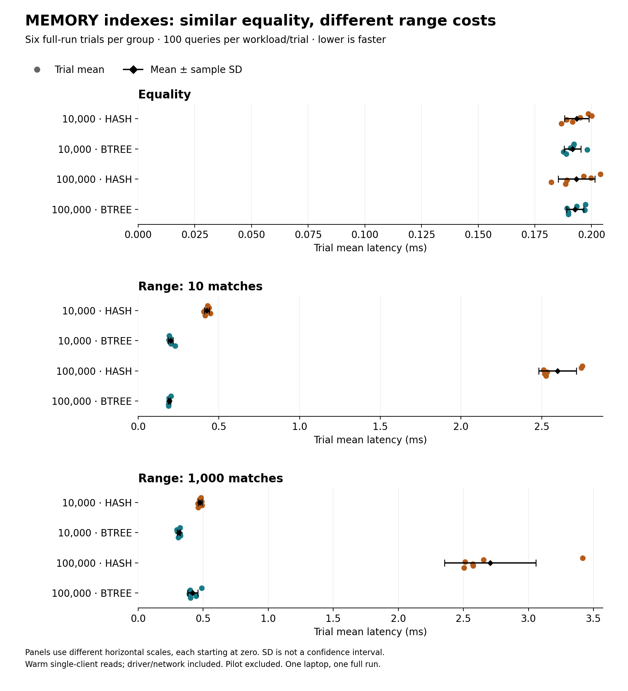
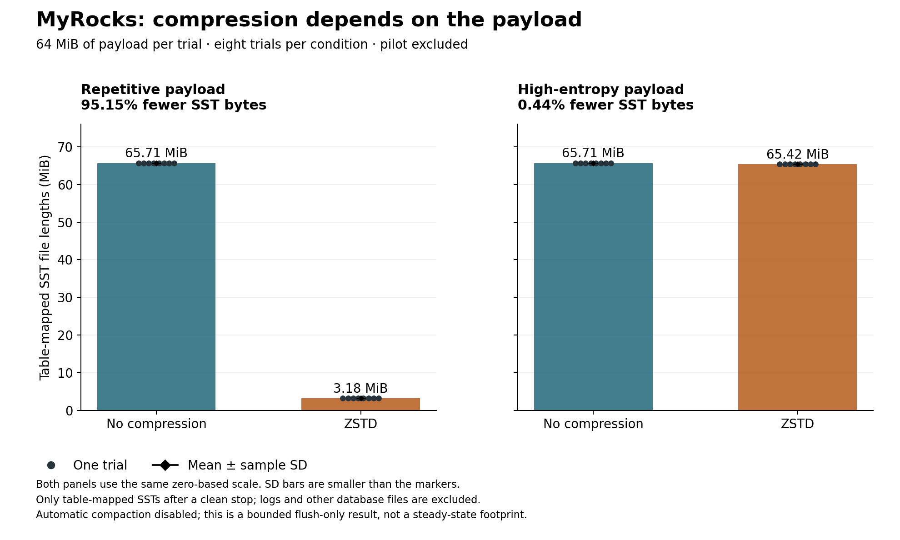
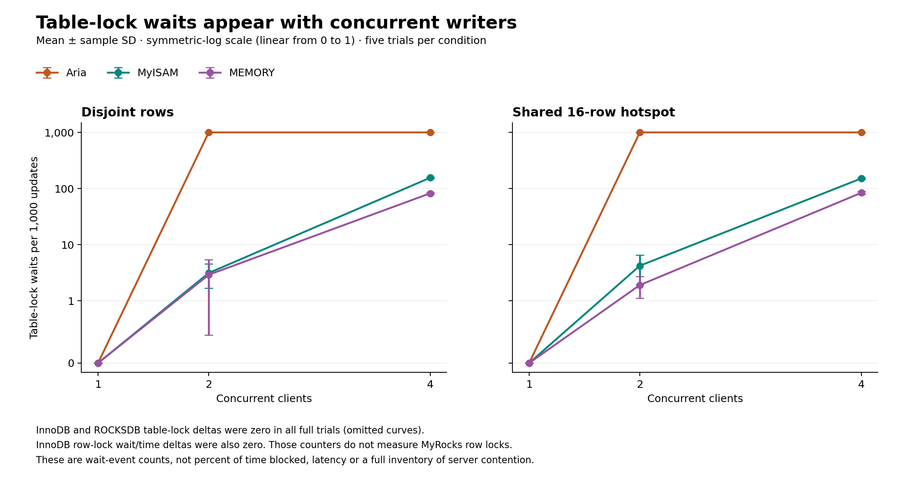

# Three measured lessons for choosing a MariaDB storage engine

*A Digital Crew project. MariaDB 11.8.9; measurements from the archived laptop runs.*

An engine choice becomes useful when it answers a workload question. Does a RAM
table need range access? Will a compression setting help the values actually
stored? Can additional writers make progress when they update different rows?
We tested these questions in three separate studies. Their results explain
specific trade-offs; they are not a combined ranking of engines.

The tables below use mean ± sample standard deviation across trials. Queries and
rows within a trial are not independent repeats. Pilots are excluded. Each study
checks every loaded row and query answer, and retains its raw observations,
controls and source fingerprints. No new measurements were made for this article.

## 1. A MEMORY table can still do the wrong kind of lookup

MariaDB's [MEMORY reference](https://mariadb.com/docs/server/server-usage/storage-engines/memory-storage-engine)
permits HASH and BTREE indexes, with HASH as the default. The important choice is
the access method the query can use, even though both tables reside in RAM.

We kept the integer schema, BTREE primary key, rows and query stream constant
within each size/round pair, changing only the secondary index on `k`. Six rounds
at 10,000 and 100,000 rows produced 24 verified trials. Each workload's trial mean
averaged 100 timed queries after validation and warmup.

At 100,000 rows:

| Secondary index | Equality (ms) | Ten-row range (ms) |
| --- | ---: | ---: |
| HASH | 0.1934 ± 0.0081 | 2.5974 ± 0.1162 |
| BTREE | 0.1928 ± 0.0038 | 0.1921 ± 0.0060 |

The HASH range mean was **13.52 times** the BTREE mean. Diagnostic replays showed
`EXPLAIN` access `ALL` and 100,001 `Handler_read_rnd_next` requests for HASH,
versus `range` access through `probe_k` and ten `Handler_read_next` requests for
BTREE. Equality used indexed access for both. The mechanism is visible in plans
and logical handler counters, rather than inferred from latency alone.

**Practical choice:** explicitly use BTREE for this kind of range access in a
rebuildable MEMORY table. The similar equality means give no clear latency reason
to prefer HASH in this experiment. Timings include driver/network work; the
13.52 ratio is a ratio of group means, not a confidence bound or a universal
speedup. Diagnostics replay one query per workload after timing, not every
timed query. Duplicate-heavy keys, writes and RAM cost were not compared.
Both index choices still lose the table's rows after a server restart.

[Full findings and observations](memory-index-findings.md) ·
[Schema, controls and commands](memory-index-method.md)

## 2. Measure compression on more than one payload

[MyRocks compression settings](https://mariadb.com/docs/server/server-usage/storage-engines/myrocks/myrocks-and-data-compression)
apply to column families and newly written SST files. Recording a configured
codec alone does not establish which files contain the table or how they were
compressed. Our trials checked the effective column-family options and mapped
the table's actual SST files through MariaDB's MyRocks information-schema tables.

The full study crossed two codecs with two deterministic payload profiles:
repetitive and high entropy. Each of the 32 fresh-volume trials loaded 65,536 rows
containing 64 MiB of payload; eight trials contributed to each condition.

| Payload | No-compression SST MiB | ZSTD SST MiB | Reduction in mean bytes |
| --- | ---: | ---: | ---: |
| Repetitive | 65.7062 ± 0.0000 | 3.1850 ± 0.0002 | 95.15% |
| High entropy | 65.7062 ± 0.0000 | 65.4158 ± 0.0001 | 0.44% |

MiB means 1,048,576 bytes. The displayed zero standard deviations are observed
identical file lengths. Percentages use the unrounded group means.

**Practical choice:** test a codec with representative values and a contrasting
payload. The repetitive profile's large saving did not transfer to the high-entropy
control. We forced a final flush, verified the files' codecs, then inventoried
unique mapped SST file lengths after a clean stop. These bytes exclude WALs,
logs and unrelated datadir files; they are not physical SSD usage. The study
does not measure steady-state compaction or isolate compression's CPU cost.
Its separately recorded load/read timings are not a general speed guarantee.

[Full findings and observations](rocksdb-compression-findings.md) ·
[Mapping, flush protocol and commands](rocksdb-compression-method.md)

## 3. Different rows do not remove table-lock contention

The concurrent-write study used five engines, 10,000 synthetic rows and a fixed
10,000 autocommit increments per trial. Five rounds covered 1, 2 and 4 clients
with disjoint key partitions or a shared 16-row hotspot: 150 verified trials in
total. Throughput and server counters were recorded separately.

Aria's disjoint-row cases illustrate why the number of connected writers is not
the same as useful write parallelism:

| Clients | Updates/s | Table-lock wait events per 1,000 updates |
| ---: | ---: | ---: |
| 1 | 877.6 ± 16.4 | 0.00 ± 0.00 |
| 2 | 955.0 ± 25.2 | 999.88 ± 0.04 |
| 4 | 953.3 ± 37.6 | 999.90 ± 0.00 |

At two and four clients, the global `Table_locks_waited` delta was about one event
per completed update, while mean throughput changed little. This directly
observes table-lock contention even when writers target different rows.
The counter counts events, not time spent waiting, so it cannot assign a fraction
of total runtime to locking or exclude logging and scheduling costs.

**Practical choice:** measure contention and client capacity alongside throughput.
Runner and database CPU observations have different windows and cannot be
subtracted to recover pure server latency. Engine order was balanced, but six
condition positions across five rounds were not perfectly balanced. These are
short bursts on a reused server, not sustained saturation. The engines also have
different durability guarantees: Aria's `TRANSACTIONAL` table option concerns
crash safety and does not supply user-transaction rollback, as the
[Aria reference](https://mariadb.com/docs/server/server-usage/storage-engines/aria/aria-storage-engine)
explains.

[Full findings and observations](write-diagnostics-findings.md) ·
[Counter definitions, CPU windows and commands](write-diagnostics-method.md)

## Try the behavior, then reproduce the measurements

The [README quick start](../README.md#start-here) runs a stock-image four-engine
correctness demonstration. The [interactive tutorial](tutorial.md) exposes the
SQL for index access, lock counters, rollback and restart persistence. Its single
runs teach behavior; they do not reproduce the statistics above.

For the full five-engine setup and repeated route comparison, use the
[advanced reproduction guide](openflights-reproduction.md). Each linked study
has its own protocol and raw evidence. [Offline reporting](report-reproducibility.md)
rechecks the archived results without repeating database workloads.

These observations came from one WSL2 laptop with recorded power, image and
resource settings. They do not establish a causal operating-system effect or
independent physical-host replication. Select an engine from the application's
transaction, persistence and access requirements first, then use representative
measurements; the [decision guide](engine-recommendations.md) connects all five
engines to those requirements.

[Digital Crew and completed contributions](team-contributions.md) ·
[Project MIT license](../LICENSE). External documentation retains its own terms.
