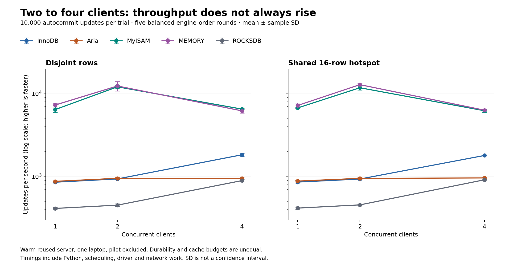
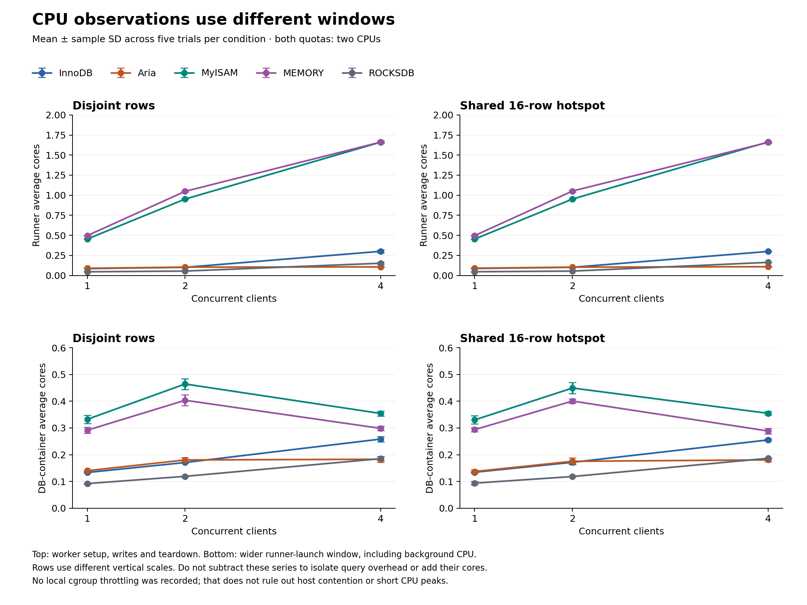
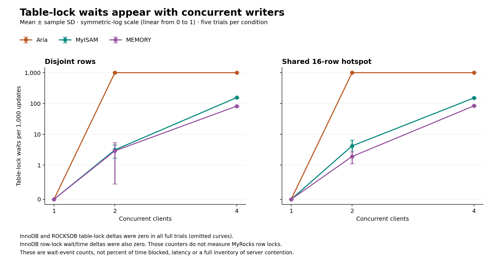

# Concurrent writes: CPU and lock-wait findings

Full run `20261017T172951Z-write-diagnostics-773525b2` contains **150 verified trials and 1,500,000 successful updates**.
Five rounds cover five engines, two patterns and 1/2/4 clients. Each trial loads
10,000 synthetic rows and executes 10,000 autocommit increments; every initial and
final row is checked. The 30-trial pilot `20261017T170909Z-write-diagnostics-31a106d2` is independently validated and
excluded from every statistic and figure below. Both runs completed on October 17,
2026 (Europe/Berlin); the evidence was archived in commit `b5eefc3`.

## Findings and decision

- Aria records almost one table-lock wait event per update with two or four clients,
  in both patterns; its mean throughput changes little from two to four clients.
  This directly observes table-lock contention, including on disjoint rows. It does
  not establish how much total runtime was spent waiting or separate logging cost.
- MyISAM and MEMORY disjoint throughput falls **46.1% and 49.8%** from two to four clients.
  Table-lock waits increase, and runner CPU rises to about 1.66 average cores.
  Both locking and client execution are relevant observations; neither was isolated
  as the sole cause. The hotspot exhibits the same broad throughput pattern.
- InnoDB records zero row-lock wait counts and time deltas in all 30 of its full
  trials, including the 16-row hotspot. This workload did not establish InnoDB
  row-lock waiting; zero here is not a general concurrency guarantee.
- No local cgroup quota-throttling periods or time were recorded for either
  container in any full trial. Average CPU does not measure instantaneous peaks,
  Python scheduling costs, host contention, I/O waits or parent cgroup limits.

**Practical implication:** for frequent concurrent updates, include lock counters
and client telemetry in workload testing; disjoint records do not remove table-lock
contention. Do not use these unequal-durability timings to prefer a non-transactional
engine for authoritative records. Start persistent transactional workloads with the
requirements-based [engine recommendations](engine-recommendations.md), then measure
representative transaction length and contention. No universal engine ranking follows.



## Complete full-run results

Mean ± sample SD across **five trials per condition**. Individual updates are not
independent repeats; SD is not a confidence interval. CPU columns use distinct
windows, detailed below, and must not be added or subtracted. Table waits are events
per 1,000 completed updates, not a percentage of blocked time.

| Engine | Pattern | Clients | Updates/s ± SD | Runner cores ± SD | DB cores ± SD | Table waits/1,000 ± SD |
| --- | --- | ---: | ---: | ---: | ---: | ---: |
| InnoDB | disjoint | 1 | 856.8 ± 11.3 | 0.085 ± 0.001 | 0.133 ± 0.001 | 0.00 ± 0.00 |
| InnoDB | disjoint | 2 | 938.4 ± 22.6 | 0.101 ± 0.003 | 0.171 ± 0.003 | 0.00 ± 0.00 |
| InnoDB | disjoint | 4 | 1834.5 ± 86.2 | 0.301 ± 0.019 | 0.258 ± 0.010 | 0.00 ± 0.00 |
| InnoDB | hotspot | 1 | 859.9 ± 40.6 | 0.087 ± 0.002 | 0.134 ± 0.003 | 0.00 ± 0.00 |
| InnoDB | hotspot | 2 | 935.5 ± 12.0 | 0.102 ± 0.002 | 0.172 ± 0.006 | 0.00 ± 0.00 |
| InnoDB | hotspot | 4 | 1799.6 ± 14.1 | 0.299 ± 0.004 | 0.255 ± 0.004 | 0.00 ± 0.00 |
| Aria | disjoint | 1 | 877.6 ± 16.4 | 0.089 ± 0.002 | 0.140 ± 0.002 | 0.00 ± 0.00 |
| Aria | disjoint | 2 | 955.0 ± 25.2 | 0.104 ± 0.007 | 0.180 ± 0.009 | 999.88 ± 0.04 |
| Aria | disjoint | 4 | 953.3 ± 37.6 | 0.107 ± 0.007 | 0.183 ± 0.011 | 999.90 ± 0.00 |
| Aria | hotspot | 1 | 883.6 ± 13.6 | 0.091 ± 0.004 | 0.137 ± 0.006 | 0.00 ± 0.00 |
| Aria | hotspot | 2 | 953.7 ± 32.2 | 0.104 ± 0.008 | 0.175 ± 0.012 | 999.88 ± 0.04 |
| Aria | hotspot | 4 | 964.6 ± 22.7 | 0.109 ± 0.005 | 0.181 ± 0.006 | 999.90 ± 0.00 |
| MyISAM | disjoint | 1 | 6437.0 ± 493.8 | 0.454 ± 0.002 | 0.332 ± 0.015 | 0.00 ± 0.00 |
| MyISAM | disjoint | 2 | 12106.9 ± 406.2 | 0.952 ± 0.006 | 0.464 ± 0.021 | 3.12 ± 1.43 |
| MyISAM | disjoint | 4 | 6523.5 ± 83.1 | 1.661 ± 0.005 | 0.354 ± 0.009 | 155.36 ± 4.73 |
| MyISAM | hotspot | 1 | 6733.4 ± 135.4 | 0.453 ± 0.001 | 0.330 ± 0.015 | 0.00 ± 0.00 |
| MyISAM | hotspot | 2 | 11801.2 ± 750.6 | 0.952 ± 0.003 | 0.449 ± 0.021 | 4.20 ± 2.26 |
| MyISAM | hotspot | 4 | 6235.7 ± 266.2 | 1.663 ± 0.004 | 0.355 ± 0.006 | 151.00 ± 4.23 |
| MEMORY | disjoint | 1 | 7302.0 ± 397.9 | 0.497 ± 0.006 | 0.292 ± 0.012 | 0.00 ± 0.00 |
| MEMORY | disjoint | 2 | 12391.4 ± 1594.9 | 1.048 ± 0.006 | 0.403 ± 0.020 | 2.90 ± 2.45 |
| MEMORY | disjoint | 4 | 6215.5 ± 375.8 | 1.662 ± 0.015 | 0.298 ± 0.008 | 82.00 ± 1.74 |
| MEMORY | hotspot | 1 | 7211.8 ± 506.4 | 0.497 ± 0.005 | 0.294 ± 0.008 | 0.00 ± 0.00 |
| MEMORY | hotspot | 2 | 12858.5 ± 346.7 | 1.052 ± 0.013 | 0.401 ± 0.009 | 1.90 ± 0.79 |
| MEMORY | hotspot | 4 | 6332.6 ± 124.1 | 1.658 ± 0.011 | 0.289 ± 0.010 | 83.60 ± 4.89 |
| ROCKSDB | disjoint | 1 | 413.9 ± 14.1 | 0.046 ± 0.002 | 0.092 ± 0.003 | 0.00 ± 0.00 |
| ROCKSDB | disjoint | 2 | 453.1 ± 16.1 | 0.055 ± 0.001 | 0.119 ± 0.003 | 0.00 ± 0.00 |
| ROCKSDB | disjoint | 4 | 895.8 ± 34.3 | 0.152 ± 0.014 | 0.185 ± 0.007 | 0.00 ± 0.00 |
| ROCKSDB | hotspot | 1 | 417.5 ± 12.5 | 0.046 ± 0.003 | 0.094 ± 0.006 | 0.00 ± 0.00 |
| ROCKSDB | hotspot | 2 | 456.5 ± 8.0 | 0.054 ± 0.001 | 0.118 ± 0.002 | 0.00 ± 0.00 |
| ROCKSDB | hotspot | 4 | 915.7 ± 7.5 | 0.163 ± 0.002 | 0.187 ± 0.002 | 0.00 ± 0.00 |

The [150-row CSV](data/write-diagnostics-observations.csv) preserves trial-level
observations. [Statistics and provenance](data/write-diagnostics-statistics.json)
include all group summaries and canonical evidence hashes. All individual statement
latencies remain in the immutable raw JSON; no significance test is claimed.

## CPU windows and limits



Throughput covers barrier release to the final successful update. Runner CPU covers
worker setup, updates and teardown. DB-container CPU is sampled by the host before
launching the writes runner and after it returns. Its wall window was **1.05–2.97 times**
the throughput interval, with a larger relative startup cost for faster workloads.
CPU seconds divided by that broader wall time gives DB average cores. This can
lower the average relative to the active update period; it is not pure query CPU.

The database samples include background server work, healthchecks and the tiny `cat`
observer. Earlier load work can continue in the background. Host timestamps bound
sample-call uncertainty; minimum/maximum windows are retained in the CSV. No idle
baseline is subtracted. These measurements separate which container consumed CPU,
but **do not decompose client/network overhead from server execution latency**.
Low average DB CPU does not prove that server CPU cannot be a bottleneck.

## What the lock counters establish



The global `Table_locks_waited` delta directly counts table locks that waited.
All single-client trials recorded zero. Aria's multi-client trials recorded roughly
10,000 events per 10,000 updates; MyISAM and MEMORY recorded fewer but more at four
clients than at two on average. InnoDB and ROCKSDB table-lock deltas were all zero.
These observations are consistent with table locking constraining concurrency,
without proving its share of elapsed time or excluding logging and scheduling.

`Innodb_row_lock_waits` and `Innodb_row_lock_time` (documented milliseconds) apply to
InnoDB. Their zero deltas do not describe MyRocks locking. Endpoint pending-wait
gauges can miss brief waits. SQL snapshots bracket worker execution, include their
own observation overhead, and are not atomic across counters. The dedicated server
limits unrelated work; it does not instrument every latch or metadata lock.
The [protocol](write-diagnostics-method.md) links the official counter definitions.

## Controls and reproducibility

- Same seeded data, schema and fixed total operation count within every condition;
  disjoint partitions or a shared 16-row hotspot. Worker barrier, no retry policy,
  actual-engine validation, complete row checks and independently regenerated hashes.
- Five engine orders are balanced. Six condition positions rotate across five
  rounds and therefore are not perfectly balanced. Tables reload each trial;
  one fresh isolated server/volume is reused across the full run. Cache/history
  effects remain, and these are short fixed-work bursts rather than sustained loads.
- MariaDB 11.8.9, Python 3.12.15, PyMySQL 1.1.2, WSL2. Recorded power condition:
  `plugged in; battery saver off`. DB quota two CPUs/2 GiB; runner two CPUs/512 MiB.
  Measured source, selected settings and runtime match across the pilot and full
  runs. **DB and runner image IDs differ between runs**; the reason is not established
  by these records. Both identities are retained, and byte-identical images across
  runs are not claimed. One DB container was observed throughout each run.
- The InnoDB buffer pool, Aria page cache, MyISAM key buffer and MyRocks block cache
  were each configured to 128 MiB. They cover different things and do not equalize
  total memory or caching. MEMORY rows/indexes live in RAM. InnoDB and MyRocks
  flush-at-commit settings were 1; binary logging was off. These engines still do
  not have equivalent durability. See the [budget inventory](cache-and-durability.md).
- Both runs stopped cleanly without OOM; successful cleanup removed only their
  isolated volumes. This run measured neither crash recovery nor power-loss safety.
  CI tests correctness, not these performance values. Independent hosts, long
  transactions, enforced collisions and server-side tracing remain broader work.

## Evidence and regeneration

- [Full results](../evidence/write-diagnostics/20261017T172951Z-write-diagnostics-773525b2/results.json), [original summary](../evidence/write-diagnostics/20261017T172951Z-write-diagnostics-773525b2/summary.md).
- [Separate pilot](../evidence/write-diagnostics/20261017T170909Z-write-diagnostics-31a106d2/results.json).
- All **540 raw stage files** match the parent run records (90 pilot, 450 full).
- [Method and run commands](write-diagnostics-method.md); [report reproduction](report-reproducibility.md).

Generate the report, derived data and three charts (PNG/SVG), without Docker or new measurements:

```powershell
python -m pip install -r requirements-report.txt
python scripts/report_write_diagnostics_findings.py
```

The generator validates schedules, final-data oracles, worker counts, telemetry
arithmetic, controls, source identities, raw stage files, summaries and clean stops.
It rejects evidence changes that invalidate the narrative rather than silently
retaining old conclusions. Canonical hashes tolerate Git line-ending conversion;
raw evidence is not rewritten. Plotting libraries and fonts can affect rendering.

Historical source fingerprints are checked against the immutable
[measured source snapshot](../provenance/write-diagnostics/README.md), not against
today's evolving Dockerfile. The statistics record measured-source and current
report-generator provenance separately. No Git history or network is required.
Use `--output-root <dir>` to generate a separate derived `docs/` tree.
